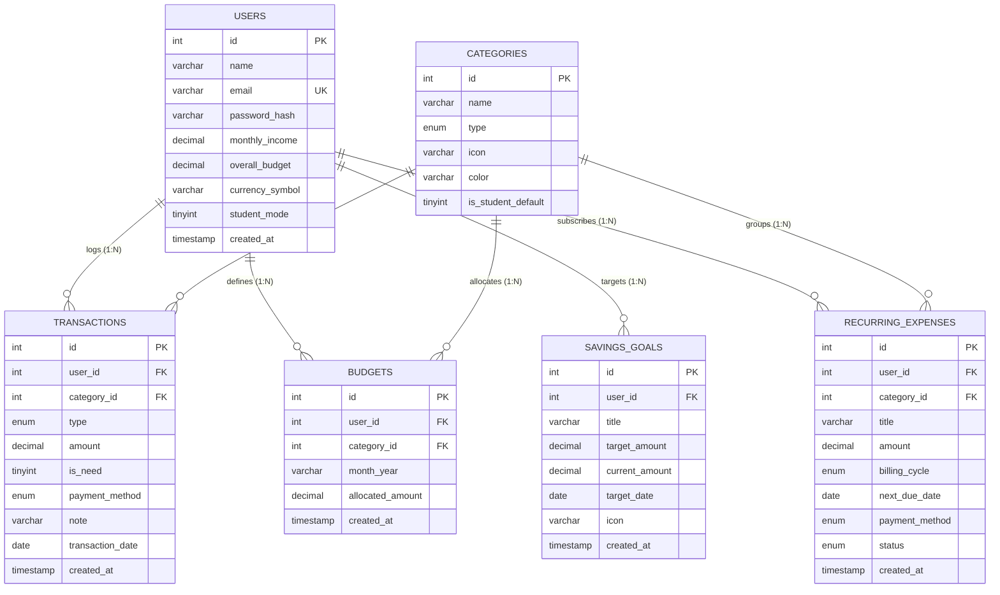

# 🗄️ Student Expense Tracker — Database Architecture & Design Report
**Project-Based Learning (PBL) Academic & Technical Documentation**  
**Schema Version:** 2.0 (Relational 3NF Model)  
**Database Engines Supported:** MySQL 8.0+ / MariaDB 10.4+ (XAMPP / phpMyAdmin) & SQLite 3  
**Application Prototype:** Student Expense Tracker (All-in-One)

---

## 1. Executive Summary

The **Student Expense Tracker** relational database is engineered specifically to address the daily financial realities of college and university students documented in the 19-slide PBL research benchmark. 

Unlike generic financial software, this database structure natively supports:
1. **Need vs. Want Classification (Slide 13 & 15):** Every expense transaction explicitly encodes whether it is an essential need (e.g., college tuition, bus pass, textbooks) or a discretionary want (e.g., eating out, party, gaming).
2. **Student-Centric Payment Modes:** Direct indexing and categorization for **UPI**, **Cash**, **Card**, and **Net Banking**.
3. **Proactive Budgeting with Health Indicators:** Monthly category limits with relational integrity and automatic threshold calculations (`Under Control`, `Getting Close`, `Exceeded`).
4. **Subscription / Recurring Bill Reminders:** Next due dates, billing frequencies, and overdue flags.
5. **Clean Slate & Admin Authority:** Shipped with **0 dummy transactions** (zero clutter) and a pre-configured Student Admin profile. In the browser prototype, all changes persist directly in Chrome's `localStorage` while strictly requiring the Admin PIN (`admin123`) to prevent unauthorized tampering.

---

## 2. Entity-Relationship (ER) Diagram

The diagram below illustrates the 6 core entities, their primary keys (`PK`), foreign keys (`FK`), and relational cardinality:



---

## 3. Database Normalization Analysis (3NF)

To guarantee ACID compliance, minimize data redundancy, and prevent update/delete anomalies, the database schema strictly satisfies **Third Normal Form (3NF)**:

### 1. First Normal Form (1NF) Compliance
- **Atomic Values:** Every column contains indivisible, single-valued entries (e.g., `payment_method` is an atomic enum, not a comma-delimited string).
- **Primary Keys:** Every table features a guaranteed surrogate Primary Key (`id INT AUTO_INCREMENT` in MySQL, `INTEGER PRIMARY KEY AUTOINCREMENT` in SQLite).
- **No Repeating Groups:** Instead of having columns like `expense1`, `expense2`, transactions are normalized as independent rows in the `transactions` table.

### 2. Second Normal Form (2NF) Compliance
- **Full Functional Dependency:** In all tables, every non-key attribute is fully functionally dependent on the entire primary key.
- In `budgets`, which maintains a logical composite uniqueness (`user_id`, `category_id`, `month_year`), a single surrogate PK `id` is utilized while a composite `UNIQUE KEY` enforces the business constraint, eliminating any partial dependency anomalies.

### 3. Third Normal Form (3NF) Compliance
- **No Transitive Dependencies:** Non-key attributes depend *only* on the primary key, with zero transitive chains ($X \to Y$ and $Y \to Z$).
- *Example:* Category name, icon, and color are stored strictly in the `categories` table. The `transactions` table stores only `category_id` (FK). If a category name or icon is edited by the Admin, it updates in exactly one place, with no redundancy in transaction records.

---

## 4. Comprehensive Data Dictionary

### Table 1: `users`
Stores student accounts, credential hashes, and baseline budget caps.

| Column | Type | Constraints | Description |
| :--- | :--- | :--- | :--- |
| `id` | `INT` | `PK`, `AUTO_INCREMENT` | Unique user identifier |
| `name` | `VARCHAR(100)` | `NOT NULL` | Student name |
| `email` | `VARCHAR(150)` | `NOT NULL`, `UNIQUE` | Student login / institutional email |
| `password_hash` | `VARCHAR(255)` | `NOT NULL` | Bcrypt hashed credential |
| `monthly_income` | `DECIMAL(10,2)` | `DEFAULT 0.00` | Baseline monthly allowance / stipend |
| `overall_budget` | `DECIMAL(10,2)` | `DEFAULT 0.00` | Monthly spending limit |
| `currency_symbol` | `VARCHAR(10)` | `DEFAULT '₹'` | Display currency symbol |
| `student_mode` | `TINYINT(1)` | `DEFAULT 1` | 1 = Student mode enabled |
| `created_at` | `TIMESTAMP` | `DEFAULT CURRENT_TIMESTAMP` | Account creation timestamp |

### Table 2: `categories`
Lookup table defining all student expense and income classifications.

| Column | Type | Constraints | Description |
| :--- | :--- | :--- | :--- |
| `id` | `INT` | `PK`, `AUTO_INCREMENT` | Unique category identifier |
| `name` | `VARCHAR(80)` | `NOT NULL` | Category label (e.g. Food & Canteen, Books) |
| `type` | `ENUM('expense','income')` | `DEFAULT 'expense'` | Transaction classification |
| `icon` | `VARCHAR(50)` | `DEFAULT '🏷️'` | Visual emoji badge |
| `color` | `VARCHAR(20)` | `DEFAULT '#4f46e5'` | Hex color for analytics charts |
| `is_student_default` | `TINYINT(1)` | `DEFAULT 1` | 1 = Shipped default, 0 = Custom admin category |

### Table 3: `transactions`
The core financial ledger recording all debit and credit entries.

| Column | Type | Constraints | Description |
| :--- | :--- | :--- | :--- |
| `id` | `INT` | `PK`, `AUTO_INCREMENT` | Unique transaction ID |
| `user_id` | `INT` | `NOT NULL`, `FK -> users.id` | User association (`ON DELETE CASCADE`) |
| `category_id` | `INT` | `NOT NULL`, `FK -> categories.id` | Category (`ON DELETE RESTRICT`) |
| `type` | `ENUM('expense','income')` | `NOT NULL` | Debit (`expense`) or Credit (`income`) |
| `amount` | `DECIMAL(10,2)` | `NOT NULL` | Transaction monetary value |
| `is_need` | `TINYINT(1)` | `DEFAULT 1` | **1 = Need (Essential)**, **0 = Want (Discretionary)** |
| `payment_method` | `ENUM('UPI','Cash','Card','Net Banking')`| `DEFAULT 'UPI'` | Payment channel used |
| `note` | `VARCHAR(255)` | `DEFAULT ''` | Specific note or merchant name |
| `transaction_date`| `DATE` | `NOT NULL` | Date expense occurred |
| `created_at` | `TIMESTAMP` | `DEFAULT CURRENT_TIMESTAMP` | Insertion audit timestamp |

### Table 4: `budgets`
Monthly category spending allocations set by the student/admin.

| Column | Type | Constraints | Description |
| :--- | :--- | :--- | :--- |
| `id` | `INT` | `PK`, `AUTO_INCREMENT` | Unique budget record ID |
| `user_id` | `INT` | `NOT NULL`, `FK -> users.id` | Student account (`ON DELETE CASCADE`) |
| `category_id` | `INT` | `NOT NULL`, `FK -> categories.id`| Budgeted category (`ON DELETE CASCADE`) |
| `month_year` | `VARCHAR(7)` | `NOT NULL` | Billing month in format `YYYY-MM` |
| `allocated_amount`| `DECIMAL(10,2)`| `NOT NULL` | Spending cap amount |
| `created_at` | `TIMESTAMP` | `DEFAULT CURRENT_TIMESTAMP` | Record creation timestamp |
| *Constraint* | `UNIQUE KEY` | `(user_id, category_id, month_year)` | Prevents duplicate category budgets per month |

### Table 5: `savings_goals`
Target savings milestones for student aspirations.

| Column | Type | Constraints | Description |
| :--- | :--- | :--- | :--- |
| `id` | `INT` | `PK`, `AUTO_INCREMENT` | Unique goal ID |
| `user_id` | `INT` | `NOT NULL`, `FK -> users.id` | User reference (`ON DELETE CASCADE`) |
| `title` | `VARCHAR(150)` | `NOT NULL` | Goal title (e.g., Laptop Upgrade, Exam Fees) |
| `target_amount` | `DECIMAL(10,2)`| `NOT NULL` | Total target savings |
| `current_amount` | `DECIMAL(10,2)`| `DEFAULT 0.00` | Cumulative amount currently deposited |
| `target_date` | `DATE` | `NOT NULL` | Target completion deadline |
| `icon` | `VARCHAR(50)` | `DEFAULT '🎯'` | Visual goal badge |
| `created_at` | `TIMESTAMP` | `DEFAULT CURRENT_TIMESTAMP` | Goal creation timestamp |

### Table 6: `recurring_expenses`
Fixed recurring bills and active college subscriptions.

| Column | Type | Constraints | Description |
| :--- | :--- | :--- | :--- |
| `id` | `INT` | `PK`, `AUTO_INCREMENT` | Unique subscription ID |
| `user_id` | `INT` | `NOT NULL`, `FK -> users.id` | Account reference (`ON DELETE CASCADE`) |
| `category_id` | `INT` | `NOT NULL`, `FK -> categories.id`| Associated category (`ON DELETE RESTRICT`) |
| `title` | `VARCHAR(150)` | `NOT NULL` | Service name (e.g., Hostel WiFi, Bus Pass) |
| `amount` | `DECIMAL(10,2)`| `NOT NULL` | Recurring cost per cycle |
| `billing_cycle` | `ENUM('monthly','quarterly','yearly')`| `DEFAULT 'monthly'` | Payment cycle frequency |
| `next_due_date` | `DATE` | `NOT NULL` | Upcoming payment date |
| `payment_method` | `ENUM('UPI','Cash','Card','Net Banking')`| `DEFAULT 'UPI'` | Preferred payment mode |
| `status` | `ENUM('active','paused')`| `DEFAULT 'active'` | Active or temporarily stopped |
| `created_at` | `TIMESTAMP` | `DEFAULT CURRENT_TIMESTAMP` | Record creation timestamp |

---

## 5. Relational SQL Views (Analytics Engine)

To power high-speed dashboard queries, 4 optimized SQL Views are included:

### View 1: `vw_student_monthly_summary`
Aggregates total monthly credits, debits, net savings, and the Need vs. Want ratio (Slide 15).
```sql
CREATE OR REPLACE VIEW `vw_student_monthly_summary` AS
SELECT 
    t.user_id,
    DATE_FORMAT(t.transaction_date, '%Y-%m') AS month_year,
    SUM(CASE WHEN t.type = 'income' THEN t.amount ELSE 0 END) AS total_income,
    SUM(CASE WHEN t.type = 'expense' THEN t.amount ELSE 0 END) AS total_expense,
    (SUM(CASE WHEN t.type = 'income' THEN t.amount ELSE 0 END) - 
     SUM(CASE WHEN t.type = 'expense' THEN t.amount ELSE 0 END)) AS net_savings,
    SUM(CASE WHEN t.type = 'expense' AND t.is_need = 1 THEN t.amount ELSE 0 END) AS needs_total,
    SUM(CASE WHEN t.type = 'expense' AND t.is_need = 0 THEN t.amount ELSE 0 END) AS wants_total
FROM `transactions` t
GROUP BY t.user_id, DATE_FORMAT(t.transaction_date, '%Y-%m');
```

### View 2: `vw_category_spending_report`
Generates category breakdowns with transaction counts and totals for doughnut/pie charts.
```sql
CREATE OR REPLACE VIEW `vw_category_spending_report` AS
SELECT 
    t.user_id,
    c.id AS category_id,
    c.name AS category_name,
    c.icon AS category_icon,
    c.color AS category_color,
    DATE_FORMAT(t.transaction_date, '%Y-%m') AS month_year,
    COUNT(t.id) AS transaction_count,
    SUM(t.amount) AS total_spent
FROM `transactions` t
JOIN `categories` c ON t.category_id = c.id
WHERE t.type = 'expense'
GROUP BY t.user_id, c.id, c.name, c.icon, c.color, DATE_FORMAT(t.transaction_date, '%Y-%m');
```

### View 3: `vw_budget_health`
Calculates spent percentage and flags status as **Under Control**, **Getting Close**, or **Exceeded**.
```sql
CREATE OR REPLACE VIEW `vw_budget_health` AS
SELECT 
    b.id AS budget_id,
    b.user_id,
    b.month_year,
    c.name AS category_name,
    c.icon AS category_icon,
    b.allocated_amount,
    COALESCE(SUM(t.amount), 0) AS spent_amount,
    (b.allocated_amount - COALESCE(SUM(t.amount), 0)) AS remaining_amount,
    ROUND((COALESCE(SUM(t.amount), 0) / b.allocated_amount) * 100, 1) AS utilization_pct,
    CASE 
        WHEN (COALESCE(SUM(t.amount), 0) / b.allocated_amount) > 0.95 THEN 'Exceeded'
        WHEN (COALESCE(SUM(t.amount), 0) / b.allocated_amount) >= 0.70 THEN 'Getting Close'
        ELSE 'Under Control'
    END AS health_status
FROM `budgets` b
JOIN `categories` c ON b.category_id = c.id
LEFT JOIN `transactions` t ON t.category_id = b.category_id 
    AND t.user_id = b.user_id 
    AND t.type = 'expense' 
    AND DATE_FORMAT(t.transaction_date, '%Y-%m') = b.month_year
GROUP BY b.id, b.user_id, b.month_year, c.name, c.icon, b.allocated_amount;
```

### View 4: `vw_upcoming_bills`
Monitors upcoming dues and calculates urgency status: **Overdue**, **Due Soon** ($\le 3$ days), or **Upcoming**.
```sql
CREATE OR REPLACE VIEW `vw_upcoming_bills` AS
SELECT 
    r.id,
    r.user_id,
    r.title,
    c.name AS category_name,
    c.icon AS category_icon,
    r.amount,
    r.billing_cycle,
    r.payment_method,
    r.next_due_date,
    DATEDIFF(r.next_due_date, CURDATE()) AS days_until_due,
    CASE 
        WHEN DATEDIFF(r.next_due_date, CURDATE()) < 0 THEN 'Overdue'
        WHEN DATEDIFF(r.next_due_date, CURDATE()) <= 3 THEN 'Due Soon'
        ELSE 'Upcoming'
    END AS urgency_status
FROM `recurring_expenses` r
JOIN `categories` c ON r.category_id = c.id
WHERE r.status = 'active';
```

---

## 6. In-Browser "🗄️ Database" Inspector Feature

The prototype contains an integrated, live **"🗄️ Database"** inspector tab directly inside `index.html` and powered by `js/database.js`:
- **Live Table Switcher:** Click on any table pill (`users`, `categories`, `transactions`, `budgets`, `savings_goals`, `recurring_expenses`) to see its full schema data types, constraints, and live records.
- **Instant SQL Dump Generator:** Evaluators or students can click **"💾 Export SQL Dump (.sql)"** to generate and download a live `.sql` script containing full DDL + `INSERT` statements of whatever data they entered into the browser.
- **Schema DDL Inspector:** One-click toggle to view the full ANSI SQL `CREATE TABLE` and `CREATE VIEW` commands directly in the browser.
- **SQL Query Sandbox:** Allows running live test queries (e.g. `SELECT * FROM categories`, `SELECT * FROM transactions WHERE is_need = 1`, etc.) with real-time tabular output.

---

## 7. How to Import the Database (MySQL / XAMPP / SQLite)

### Method A: Importing into MySQL / MariaDB (XAMPP / phpMyAdmin)
1. Start Apache & MySQL in **XAMPP Control Panel**.
2. Open your browser and go to `http://localhost/phpmyadmin`.
3. Click on the **Import** tab at the top.
4. Click **Choose File** and select:
   `student-expense-tracker/backend/database.sql`
5. Click **Import** at the bottom.
6. The database `student_expense_tracker` will be created with all 6 tables, foreign keys, views, and initial categories.

### Method B: Using MySQL Command Line
```bash
mysql -u root -p < "C:\Users\LENOVO\Desktop\student-expense-tracker\backend\database.sql"
```

### Method C: Using SQLite 3 / DB Browser for SQLite
```bash
sqlite3 student_expense.db < "C:\Users\LENOVO\Desktop\student-expense-tracker\backend\database_sqlite.sql"
```
Or open `DB Browser for SQLite`, click **File -> Import -> Database from SQL file...**, and select `database_sqlite.sql`.

---

## 8. College Viva & Examination Q&A

**Q1: Why is this database in 3rd Normal Form (3NF)?**  
*Answer:* Because every table has a defined primary key (1NF), all non-key columns depend on the entire primary key (2NF), and there are no transitive dependencies (3NF). For example, Category information (name, color, icon) is stored only in the `categories` table and referenced by `category_id` in `transactions`, preventing duplicate storage and update anomalies.

**Q2: How does this database support the PBL finding that students need "Need vs Want" tracking?**  
*Answer:* The `transactions` table contains a dedicated column `is_need TINYINT(1)` (1 = Need, 0 = Want). This allows SQL queries and views (`vw_student_monthly_summary`) to instantly separate essential survival expenses (fees, canteen, bus pass) from discretionary spending (gaming, shopping, weekend trips).

**Q3: How are data integrity and orphan records handled?**  
*Answer:* We use strict Foreign Key constraints:
- `ON DELETE CASCADE` on `user_id` ensures that if a student profile is deleted, all their associated transactions, budgets, goals, and subscriptions are safely cleaned up.
- `ON DELETE RESTRICT` on `category_id` prevents deleting a category that is still referenced by existing financial transactions.

**Q4: Where does the prototype store data when run offline in Chrome?**  
*Answer:* The prototype persists all relational tables in Chrome's structured `localStorage`. The new **🗄️ Database** tab lets any user or evaluator view these relational records, execute SQL queries in-browser, or export a `.sql` dump file ready to import directly into MySQL or SQLite.
